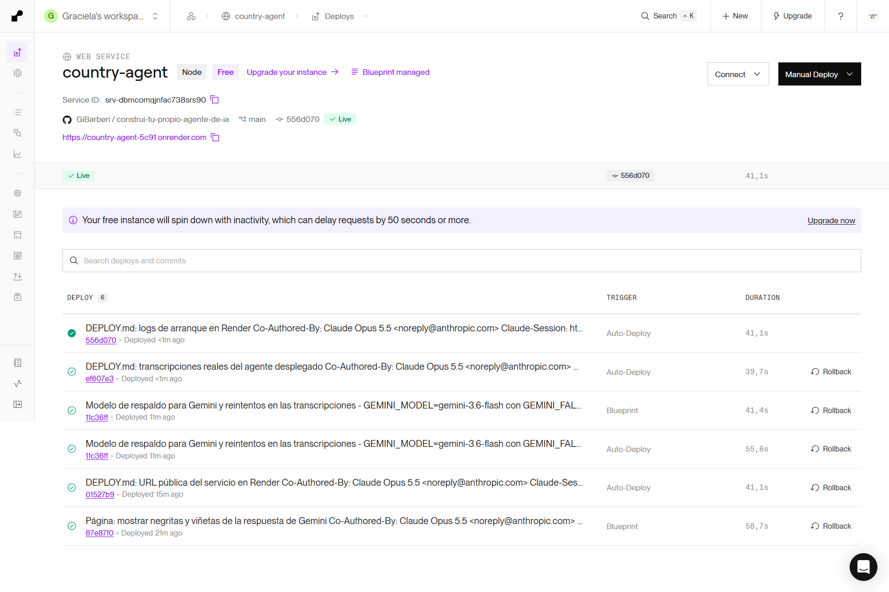

# Despliegue — Agente de países en Render

El agente corre como un **Web Service de Render** (plan gratuito). En un mismo contenedor corren las dos piezas:

- **El host** (`node dist/http.js`): servidor HTTP, Gemini y bucle de razonamiento.
- **El servidor MCP** (`dist/server.js`): el host lo lanza como subproceso y se comunica con él por **stdio**.

Como las dos piezas viven en el mismo contenedor, no hace falta un túnel ni exponer el servidor MCP a internet.

## 1. URL pública

**https://country-agent-5c91.onrender.com**

El plan gratuito de Render hiberna el servicio tras 15 minutos sin uso, y el primer pedido después de eso tarda unos 30 a 60 segundos en responder. Por eso la evidencia verificable está en las secciones siguientes, commiteada en este repositorio.

## 2. Archivo de configuración del hosting

[`render.yaml`](render.yaml), en la raíz del repositorio:

```yaml
services:
  - type: web
    name: country-agent
    runtime: node
    plan: free
    buildCommand: npm ci && npm run build
    startCommand: npm start
    healthCheckPath: /health
    envVars:
      - key: NODE_VERSION
        value: "22"
      - key: GEMINI_MODEL
        value: gemini-3.6-flash
      - key: GEMINI_FALLBACK_MODEL
        value: gemini-flash-latest
      - key: GEMINI_API_KEY
        sync: false
      - key: RESTCOUNTRIES_API_KEY
        sync: false
```

- `npm ci` instala exactamente las versiones del `package-lock.json` commiteado.
- `npm start` ejecuta el archivo transpilado (`node dist/http.js`), no el de desarrollo.
- Los secretos (`sync: false`) se cargan a mano en el panel de Render y nunca entran al repositorio.
- `healthCheckPath` hace que Render solo dé el servicio por activo cuando `/health` responde, es decir, cuando el host ya se conectó al servidor MCP.

## 3. Panel del hosting



## 4. Logs de arranque en Render

Copiados del panel de Render (**country-agent → Logs**). Las líneas muestran el arranque en orden:

1. Se validan las variables de entorno.
2. El host lanza el servidor MCP como subproceso (`servidor iniciado por stdio`).
3. Descubre las herramientas con `tools/list`.
4. Empieza a escuchar en el puerto que asigna Render (`10000`).

Las líneas `[country-agent-server]` llegan por el `stderr` del servidor MCP, que deja `stdout` libre para JSON-RPC.

<!-- logs:inicio -->

```text
[startup] Iniciando country-agent…
[startup] Modelo: gemini-3.6-flash (respaldo: gemini-flash-latest) · máximo de iteraciones: 5
[country-agent-server] servidor iniciado por stdio
[country-agent-server] tools/list
[startup] Conectado a country-agent-server por stdio
[startup] Herramientas descubiertas (tools/list): get_country_info, get_country_neighbors
[startup] Agente escuchando en el puerto 10000
```

<!-- logs:fin -->

## 5. Transcripción de conversaciones con el agente desplegado

Generadas con `npm run transcripts -- <URL>`, que envía las preguntas al agente desplegado y registra qué herramientas invocó, con qué argumentos y qué devolvieron.

<!-- transcripciones:inicio -->

Generado el 2026-11-05T18:51:38.258Z contra `https://country-agent-5c91.onrender.com`.

### Conversación 1 — Consulta de varios pasos

```text
Usuario: ¿Cuál de los países limítrofes de Brasil tiene mayor población?

[iteración 1] get_country_neighbors({"countryName":"Brazil"}) → OK
    resultado: {"country":"Brazil","neighbors":[{"code":"ARG","name":"Argentina"},{"code":"BOL","name":"Bolivia"},{"code":"COL","name":"Colombia"},{"code":"GUF","name":"French Guiana"},{"code":"GUY","name":"Guyana"},{"code":"PRY","name":"Paraguay"},{"code":"PER","name":"Peru"},{"code":"SUR","name":"Suriname"},{"code":"URY","name":"Uruguay"},{"code":"VEN","name":"Venezuela"}]}
[iteración 2] get_country_info({"countryName":"Argentina"}) → OK
    resultado: {"name":"Argentina","capital":"Buenos Aires","population":46466688,"region":"Americas"}
[iteración 2] get_country_info({"countryName":"Bolivia"}) → OK
    resultado: {"name":"Bolivia","capital":"Sucre","population":11365333,"region":"Americas"}
[iteración 2] get_country_info({"countryName":"Colombia"}) → OK
    resultado: {"name":"Colombia","capital":"Bogotá","population":53399171,"region":"Americas"}
[iteración 2] get_country_info({"countryName":"French Guiana"}) → OK
    resultado: {"name":"French Guiana","capital":"Cayenne","population":254541,"region":"Americas"}
[iteración 2] get_country_info({"countryName":"Guyana"}) → OK
    resultado: {"name":"Guyana","capital":"Georgetown","population":956044,"region":"Americas"}
[iteración 2] get_country_info({"countryName":"Paraguay"}) → OK
    resultado: {"name":"Paraguay","capital":"Asunción","population":6109644,"region":"Americas"}
[iteración 2] get_country_info({"countryName":"Peru"}) → OK
    resultado: {"name":"Peru","capital":"Lima","population":34157732,"region":"Americas"}
[iteración 2] get_country_info({"countryName":"Suriname"}) → OK
    resultado: {"name":"Suriname","capital":"Paramaribo","population":616500,"region":"Americas"}
[iteración 2] get_country_info({"countryName":"Uruguay"}) → OK
    resultado: {"name":"Uruguay","capital":"Montevideo","population":3480601,"region":"Americas"}
[iteración 2] get_country_info({"countryName":"Venezuela"}) → OK
    resultado: {"name":"Venezuela","capital":"Caracas","population":28633711,"region":"Americas"}

Agente: El país limítrofe de Brasil con mayor población es **Colombia**, con **53.399.171 habitantes**. 

A modo de comparación, las poblaciones de sus vecinos son:
- **Colombia:** 53.399.171
- **Argentina:** 46.466.688
- **Perú:** 34.157.732
- **Venezuela:** 28.633.711
- **Bolivia:** 11.365.333
- **Paraguay:** 6.109.644
- **Uruguay:** 3.480.601
- **Guyana:** 956.044
- **Surinam:** 616.500
- **Guayana Francesa:** 254.541

(iteraciones del modelo: 3)
```

### Conversación 2 — Consulta fuera de alcance

```text
Usuario: ¿Cómo hago una pizza?

[herramientas] Ninguna: el agente no invocó herramientas.

Agente: Lo siento, no puedo ayudarte con recetas ni consultas que no estén relacionadas con información geográfica de países. 

Puedo ayudarte a responder preguntas sobre:
- La **capital**, la **población** y la **región/continente** de cualquier país.
- Los **países limítrofes** (fronteras terrestres) de un país determinado.

Si querés saber datos sobre algún país, ¡solo preguntame!

(iteraciones del modelo: 1)
```

<!-- transcripciones:fin -->

## Cómo reproducir el despliegue

1. En Render: **New → Blueprint** y elegí este repositorio. Render lee `render.yaml`.
2. Cargá `GEMINI_API_KEY` y `RESTCOUNTRIES_API_KEY` cuando el panel las pida.
3. Render corre `npm ci && npm run build` y después `npm start`. El servicio queda activo cuando `/health` responde `200`.
