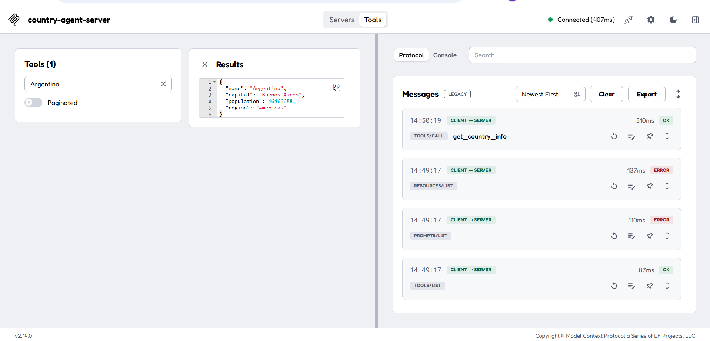

# Construí tu propio agente de IA — Agente de países

Agente de IA construido por etapas sobre la [REST Countries API](https://restcountries.com).

> **Nota sobre la API:** REST Countries deprecó la v3.1 que usaba el curso: ahora responde un aviso en lugar de datos. El servicio usa la **v5** (`api.restcountries.com/countries/v5`), que requiere una API key gratuita en `RESTCOUNTRIES_API_KEY`. El cambio quedó encapsulado en `countries.service.ts`: los esquemas, el servidor MCP y el contrato de salida no cambiaron.

| Etapa | Qué agrega | Estado |
| --- | --- | --- |
| Preentrega 1 | Capa de datos validada con Zod (`getCountryInfo`) | ✅ |
| Preentrega 2 | Servidor MCP `country-agent-server` con la herramienta `get_country_info` por stdio | ✅ |
| Proyecto Final | Host con Gemini que descubre la herramienta y orquesta el ciclo de razonamiento | Pendiente |

## Estructura

```
src/
├── schemas/
│   ├── country-input.schema.ts    # Contrato de entrada (también es el contrato de la tool MCP)
│   └── country-output.schema.ts   # Contrato de salida (el objeto limpio)
├── services/
│   └── countries.service.ts       # getCountryInfo: validar → consultar → validar salida
├── config/
│   └── env.ts                     # Variables de entorno validadas con Zod (RESTCOUNTRIES_API_KEY, GEMINI_API_KEY)
├── server.ts                      # Servidor MCP: capa de transporte, sin lógica de negocio
└── demo.ts                        # Demo de la capa de datos (Preentrega 1)
scripts/
├── mcp-exchange.mjs               # Cliente JSON-RPC mínimo que conversa con el servidor por stdio
└── update-evidence.mjs            # Genera la evidencia y la pega en este README
docs/
└── mcp-inspector.png              # Captura del MCP Inspector
```

## Arquitectura en capas

```
Cliente MCP (Inspector, Claude Desktop, host con Gemini)
        │  JSON-RPC sobre stdio
        ▼
src/server.ts ─────────── transporte + tools/list + tools/call
        │  importa
        ▼
src/services/countries.service.ts ── lógica de negocio (Preentrega 1, sin cambios)
        │  valida con
        ▼
src/schemas/*.schema.ts ── contratos de entrada y salida
```

`server.ts` no contiene ni un `fetch`: solo anuncia la herramienta, valida los argumentos e invoca `getCountryInfo`.

## Preentrega 1 — Contrato de datos

**Entrada (`CountryInputSchema`)**

| Campo | Regla |
| --- | --- |
| `countryName` | string, `.trim()`, mínimo 2 caracteres, pasado a minúsculas con `.transform()` |

**Salida (`CountryOutputSchema`)**

| Campo | Tipo | Regla |
| --- | --- | --- |
| `name` | string | no vacío |
| `capital` | string | no vacío |
| `population` | number | `.refine()`: no puede ser negativa |
| `region` | string | no vacío |

`getCountryInfo` trabaja en tres pasos:

1. Valida la entrada con `safeParse` (`INVALID_INPUT`).
2. Consulta la API (`CONFIG_ERROR` si falta la API key, `NOT_FOUND`, `API_ERROR`, `NETWORK_ERROR`).
3. Valida la salida (`INVALID_RESPONSE`).

Siempre devuelve `{ ok: true, data }` o `{ ok: false, error: { code, message } }` y nunca usa `.parse()`.

## Preentrega 2 — Servidor MCP

- **Identidad:** `country-agent-server` versión `1.0.0`, con la capacidad `tools`.
- **`tools/list`:** anuncia `get_country_info` con su descripción y su `inputSchema` (`countryName` obligatorio, string, mínimo 2 caracteres). La descripción del parámetro se toma del esquema de Zod, así el contrato vive en un solo lugar.
- **`tools/call`:**
  1. Valida los argumentos con `CountryInputSchema.safeParse()` antes de ejecutar nada. Si no cumplen el contrato, nunca se llega al `fetch`.
  2. Invoca `getCountryInfo`.
  3. Devuelve el resultado como contenido `text` en formato JSON.
- **Errores:** los argumentos inválidos, el país inexistente y las fallas de la API vuelven como un resultado con `isError: true` y un JSON `{ code, message }` legible. Ninguna excepción corta la sesión.
- **Transporte:** `StdioServerTransport`. Todo el logging va a `stderr` con `console.error`, y el servidor no tiene ningún `console.log`.

## Instalación y uso

Requiere Node.js 18 o superior.

```bash
npm install
cp .env.example .env     # completá RESTCOUNTRIES_API_KEY (gratis en restcountries.com/sign-up)
npm run build            # compila TypeScript a dist/
npm start                # arranca el servidor MCP por stdio (node dist/server.js)
```

Otros comandos:

```bash
npm run demo             # demo de la capa de datos (Preentrega 1)
npm run inspector        # abre el MCP Inspector conectado al servidor
npm run evidence         # regenera la sección Evidencia de este README
```

### Ejemplo de mensaje JSON-RPC

Con el servidor corriendo (`npm start`), cada mensaje se envía por `stdin` como una línea de JSON. Primero va el handshake (`initialize` y la notificación `notifications/initialized`) y después se llama a la herramienta:

```json
{"jsonrpc":"2.0","id":3,"method":"tools/call","params":{"name":"get_country_info","arguments":{"countryName":"Argentina"}}}
```

### Usarlo desde Claude Desktop

```json
{
  "mcpServers": {
    "country-agent-server": {
      "command": "node",
      "args": ["/ruta/absoluta/al/repo/dist/server.js"]
    }
  }
}
```

## Evidencia

### Preentrega 1 — Salida de `npm run demo`

Tres escenarios: país válido, país inexistente y entrada inválida.

<!-- evidencia:inicio -->

_Pendiente: ejecutar `npm run evidence`._

<!-- evidencia:fin -->

### Preentrega 2 — Intercambio JSON-RPC por stdio

Handshake, `tools/list` y tres llamadas a `tools/call`: país válido, país inexistente y argumentos inválidos.

<!-- evidencia-mcp:inicio -->

_Pendiente: ejecutar `npm run evidence`._

<!-- evidencia-mcp:fin -->

### Preentrega 2 — MCP Inspector


